 

 

### ✦ about

I work as an **IT Operator at a fintech bank** in Suriname by day and study software engineering at **UNASAT** the rest of the time.

The two feed each other more than I expected. Watching how a production banking environment actually breaks, gets monitored, and gets patched has shaped what I want to build more than any course has.

I started in full-stack because it let me ship things quickly. Now I'm moving toward **backend engineering**, and most of my time goes into **Java, Spring Boot and PostgreSQL**. Somewhere along the way I got more interested in what happens when the request lands than in what the button looks like.

**Authentication flows, state machines, failure modes**, and the infrastructure between an application and the outside world are the parts I keep coming back to.

I don't collect frameworks. I'd rather spend three months understanding **Spring Security's filter chain** than skim ten tutorials on ten different stacks.

 

### ✦ stack

<table>
<tr>
<td align="center" width="20%">BACKEND  </td>
<td align="center" width="20%">DATA  </td>
<td align="center" width="20%">FRONTEND  </td>
<td align="center" width="20%">INFRA  </td>
<td align="center" width="20%">SECURITY  
 
 

</td>
</tr>
</table>

### ✦ projects

Each of these started because I wanted to understand one specific thing properly, not because I needed portfolio filler.

 

#### [RigSight](https://github.com/NikhCodes/rigsight) · simulated industrial monitoring platform

I wanted to know what a backend looks like when it isn't just answering CRUD requests but reacting to continuous data: thresholds, state transitions, and repeated alerts that need deduplicating instead of spamming. JWT-secured with role-based access, a Flyway-managed schema, and Dockerized PostgreSQL.

`Java 21` `Spring Boot` `Spring Security` `JWT` `Hibernate` `PostgreSQL` `Flyway` `Docker`

 

<table>
<tr>
<td width="50%" valign="top">

**AGAS**: built for a university module, but I used it to go deeper on backend security than the assignment asked for. Bcrypt hashing, a three-role authorization model, and an append-only JSONB audit log so nothing gets silently overwritten. UUID keys and soft deletes throughout.

`Node.js` `Express` `PostgreSQL` `JWT` `bcrypt` `Helmet` `Joi`

</td>
<td width="50%" valign="top">

**[NIKH.EXE](https://github.com/NikhCodes/nikh-exe)**: my personal corner of the internet. A guestbook backed by Postgres, and a v2 in progress with a private admin panel, a media library and a few easter eggs for anyone who goes looking.

`Vercel` `Neon Postgres`

</td>
</tr>
<tr>
<td width="50%" valign="top">

**[NikhOS](https://github.com/NikhCodes/NikhOS)**: a grade and assignment tracker I actually use every day. Local-first with no mandatory login, keyboard-friendly, and built to feel calm rather than busy. [Try it live →](https://nikh-os-red.vercel.app)

`React` `Vite` `Tailwind CSS` `Framer Motion`

</td>
<td width="50%" valign="top">

**[Pose Cam](https://github.com/NikhCodes/face-tracker)**: real-time hand gesture detection in the browser. No trained models; gestures are classified purely from landmark geometry, plus a pose editor to add new ones. I wanted to understand computer vision as math before reaching for anything pretrained.

`React` `Vite` `MediaPipe`

</td>
</tr>
</table>

<b>MicroJobs.sr</b>: my UNASAT capstone, a freelance marketplace built for Suriname. Next.js with a custom Tailwind design system, Framer Motion, and a bit of local personality in the details.  <code>Next.js</code> <code>Tailwind CSS</code> <code>Framer Motion</code>

<picture>
  <source media="(prefers-color-scheme: dark)" srcset="https://raw.githubusercontent.com/NikhCodes/NikhCodes/output/github-contribution-grid-snake-dark.svg">
  
</picture>

  

